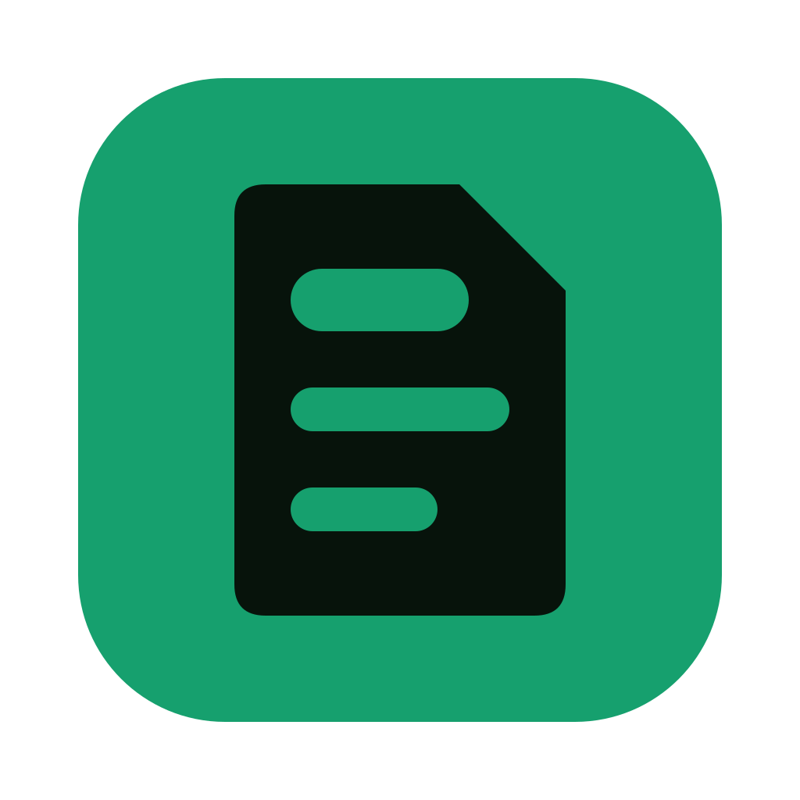
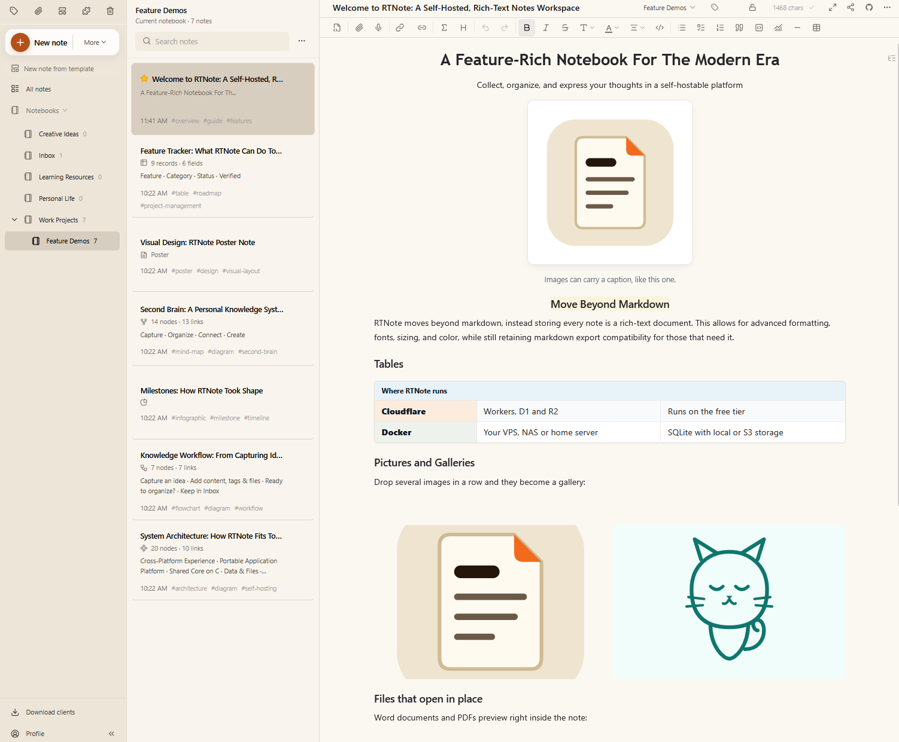
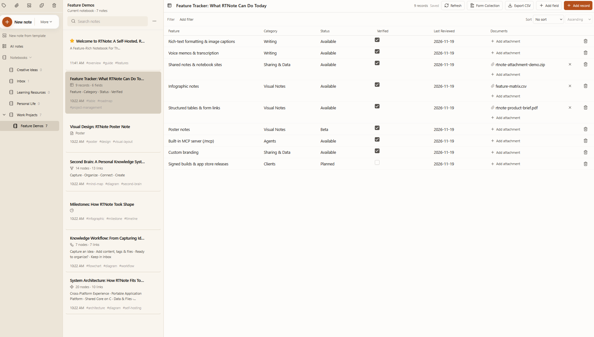
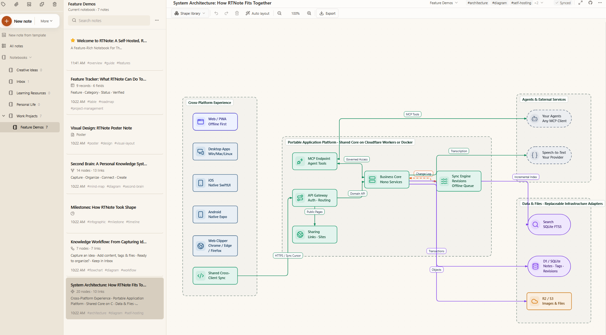

<div align="center">
  <h1>
     RTNote
  </h1>
  <p><b>A rich-text-first, self-hostable notes workspace for web, desktop and mobile.</b></p>
</div>

RTNote is an open-source notes app with a classic three-pane layout (notebooks · note list · editor), instant multi-device sync, and a built-in MCP server for external agents. It runs on Cloudflare's free tier or on your own server with Docker.


<p align="center">
  
</p>

## More than text notes

Besides ordinary rich-text notes, RTNote has typed notes that live in the same notebooks, sync the same way and can be shared the same way.

<p align="center">
  
</p>

**Table notes** are small databases: typed fields, filters and sorting, per-record attachments, CSV export and public form links for collecting responses.

<p align="center">
  
</p>

**Diagram notes** are an editable canvas with a shape library, grouped regions, labelled connectors, auto layout, zoom and export. Flowcharts, mind maps and architecture diagrams all use it.

## Principles

- **Rich text first.** Notes are stored as rich-text documents. Markdown is an import and export format, not the source of truth.
- **Richer formatting.** Fonts, text alignment, better tables, image captions, colour and highlight.
- **No built-in AI writing assist.** A built-in MCP server lets you connect the agents you choose instead.
- **Fully brandable.** Name, logo and colour scheme, including on shared notebooks and pages.
- **English by default**, with other languages available as translations.
- **Voice memos** recorded straight into notes.

## Features

**Writing**

- TipTap/ProseMirror editor with fonts, text sizes, alignment and line spacing, text colour and highlight, tables with merged and coloured cells, captioned images, image galleries, task lists, maths, code blocks and Mermaid diagrams (insert from the slash menu)
- Voice memos on web, desktop, Android and iOS: record, pause and resume into a note, play back with seeking, add a title, and transcribe with your own speech provider. Recordings are ordinary attachments, saved on the device first when offline, and transcripts are searchable
- Note outline, focus mode, a quick note switcher, and notes that open in their own window on desktop
- Templates for starting new notes, and a welcome note that shows what the editor can do

**Note types**

- Table notes with typed fields, filters, sorting, per-record attachments, CSV export and public form links
- Diagram notes: flowcharts, mind maps (with an outline editor) and architecture diagrams, with auto layout and image export
- Infographic notes, including timelines and milestones, with a gallery of layouts
- Poster notes with 40 templates, 12 platform presets, layers, and PNG, JPEG or WebP export (see [Poster notes](docs/poster-notes.md))

**Organising and finding**

- Nested notebooks with colours, tags, pinned notes, drag-and-drop sorting and fast full-text search
- Attachments up to 1 GiB with client-side image compression, plus an assets view across all notes
- Revision history for every note

**Sync and sharing**

- Offline-first sync across web (PWA), desktop, Android and iOS
- Public sharing of single notes or whole notebooks as static sites, with search, optional passwords and expiry
- Notebook sites with their own branding, so shared pages carry your name, logo and colours

**Agents and extensions**

- Remote MCP server so external agents can read and write notes, tables, diagrams and posters, with read-only or full-access tokens (see the [MCP guide](docs/mcp-guide.md))
- Plugins and no-code themes from a built-in marketplace, GitHub repositories or manifest URLs (see the [plugin guide](docs/plugin-development.md))
- Web clipper for Chrome, Edge and Firefox

**Moving in and out**

- Import from Evernote, Notion, Obsidian, Joplin, Memos and Markdown
- ZIP backup, scheduled desktop backups and Markdown export

## Clients

| Client | Location | Stack |
| --- | --- | --- |
| Web / PWA | `apps/web` | Vite, React, TipTap |
| Desktop (Windows, macOS, Linux) | `apps/desktop`, `crates/desktop-sidecar` | Electron + Rust sidecar |
| Android | `apps/mobile` | Expo / React Native |
| iOS | `apps/ios` | SwiftUI |
| Web clipper | `apps/extension` | Manifest V3 |
| API and MCP | `apps/api` | Hono on Cloudflare Workers or Bun |

GitHub Actions builds Windows, Linux and macOS installers and both web clipper packages (the Android APK build is paused for now). Pushing a version tag publishes them all to a GitHub Release. See [Builds and releases](docs/builds.md) for install notes; desktop and clipper builds are not code-signed yet.

## Deployment

### Cloudflare (free tier)

RTNote deploys to Cloudflare Workers with D1 and R2. Fork this repository, create the D1 database `rtnote` and R2 bucket `rtnote-resources`, create a Worker named `rtnote` with the runtime secret `RTNOTE_AUTH_PASSWORD`, then connect the Worker to your Fork's `main` branch with Workers Builds. Every push to `main` builds, migrates and deploys.

- [Step-by-step online deployment](docs/deploy-cloudflare-button.md)
- [Deploying with an AI agent](docs/agent-deploy-cloudflare.md)
- [Workers Builds configuration](docs/cloudflare-workers-builds.md)

The resource names and `RTNOTE_*` settings above are fixed identifiers; use them exactly as written.

### Docker

Docker runs the same application on a VPS, NAS or home server, using SQLite with local files or S3-compatible storage. Tagged releases publish a multi-platform image to `ghcr.io/madlyfx/rtnote`. Until the first release, build it from this repository:

```sh
docker compose up -d --build
```

See [Deploy with Docker](docs/deploy-docker.md) and [Self-hosting architecture](docs/self-hosting-architecture.md).

## Development

```sh
bun install
bun run dev
```

Local development signs in automatically; fresh databases use `owner` / `rtnote-local-dev`.

Checks run in CI:

```sh
bun run lint
bun run typecheck
bun run typecheck:mobile
bun run build:web
bun run test
```

See [CONTRIBUTING.md](CONTRIBUTING.md) for the workflow and [AGENTS.md](AGENTS.md) for project rules.

### Repository layout

```text
apps/web          Vite + React frontend and PWA
apps/api          Hono API and MCP endpoint (Cloudflare Worker or Bun)
apps/desktop      Electron desktop shell and packaging
apps/mobile       Expo + React Native Android app
apps/ios          SwiftUI iOS app with a bundled TipTap editor
apps/extension    Chrome/Edge/Firefox web clipper
packages/shared   Shared types, schemas, editor schema and i18n catalogs
packages/client   Shared API client
crates/           Rust desktop sidecar (local SQLite, offline data, backups)
migrations/       Append-only database migrations shared by D1 and SQLite
docs/             Deployment, migration and design documents
```

### Note storage

Each note keeps three representations:

```text
content_json      TipTap/ProseMirror document, the source of truth
content_markdown  Generated Markdown for export, sharing and MCP
content_text      Plain text for search and summaries
```

## Credits

RTNote is built on code from [EdgeEver](https://github.com/tianma-if/edgeever) by tianma-if and contributors, and is developed independently; it is not affiliated with or endorsed by that project. The poster workspace is adapted from [Qiaomu Design](https://github.com/joeseesun/qiaomu-cover-design) under the MIT license. See [NOTICE](NOTICE) for full attribution.

## License

RTNote is licensed under the [GNU Affero General Public License v3.0](LICENSE). If you run a modified RTNote as a network service, you must offer its source code to your users.

RTNote is not affiliated with Evernote Corporation.
