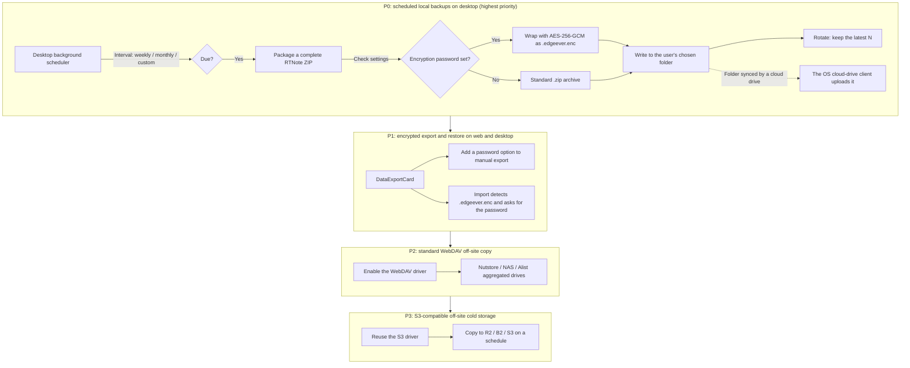

# RTNote Backup and Disaster Recovery Plan

> This document responds to the request in GitHub Issue [#61](https://github.com/MadlyFX/rtnote/issues/61) for "encrypted backups copied to cloud drives or object storage". It sets out RTNote's backup strategy, technical constraints, priorities and implementation plan. The delivered design is [Desktop scheduled backups and encrypted recovery](desktop-scheduled-backup-design.md); this document is the original proposal.

---

## 1. Background and core needs

### 1.1 Problem
RTNote mainly runs on Cloudflare serverless (a D1 database plus R2 object storage / KV) or in a self-hosted Docker container.
Cloud providers offer high SLAs, but knowledge-base and personal-note users have two core concerns:
1. **Single point of failure in the cloud and instance loss (extreme disaster recovery)**:
   - A Cloudflare account flagged or suspended by mistake, a failed payment, an accidental D1 reset, or a physically failed disk on a VPS host.
   - Users need an **independent cold copy that does not depend on the current cloud runtime at all**.
2. **Privacy and data ownership (encryption at rest)**:
   - Off-site backups usually live in third-party storage (cloud drives, public object storage).
   - Notes include private journals and sensitive memos. Uploading plain archives risks third-party inspection or a misconfigured bucket leaking data, so **strong client-side end-to-end encryption** is essential.

---

## 2. Strategy and established approaches

### 2.1 Established approaches (Obsidian / Joplin / SiYuan)

| Path | Mechanism | Strength | Fits |
| :--- | :--- | :--- | :--- |
| **Option A: local folder (a cloud-drive client takes over)** | The desktop app only writes archives on a schedule; the user points the folder at a synced cloud-drive folder (iCloud / OneDrive / Nutstore) | **No network code, fully reliable**: mature OS and vendor sync daemons handle resumable and incremental retries | Zero-configuration cloud backup for 90% of desktop users |
| **Option B: standard WebDAV** | A standard HTTP protocol with account plus app-specific password (no OAuth hassle) | Connects directly to Nutstore or a NAS (Synology / Nextcloud), and to other cloud drives indirectly through **Alist** | Advanced self-hosting and NAS users |
| **Option C: S3-compatible object storage** | Standard AWS SigV4 authentication with static access keys | Very low-cost off-site cold storage (Cloudflare R2 / Backblaze B2 / AWS S3 / Alibaba Cloud OSS) | Technical users who want cheap cloud backup |

### 2.2 Conclusion: the highest-priority strategy
**"The desktop app periodically exports a backup to a local folder (user-chosen path, optional encryption)" is P0.**
- **Last line of defence**: even if the cloud instance vanishes, the user's own machine always holds a complete, independent, recent archive.
- **Off-site copies without maintenance**: the user only has to choose a folder synced by their cloud drive to get multi-device cold backups.
- **Avoids runtime limits**: sidesteps the Cloudflare Worker free plan's 50 ms CPU limit and memory limits for large files.

---

## 3. Phased roadmap



---

## 4. Detailed design: P0 scheduled desktop backups

### 4.1 Archive format: the standard RTNote ZIP
Rather than a raw SQLite snapshot, scheduled backups use the **standard self-contained archive**:
- `manifest.json`: instance version, packaging time, note count, resource checksums;
- `memos/`: one JSON file per note (keeping the structured document tree) plus plain Markdown;
- `notebooks.json`: the notebook hierarchy;
- `prompts.json`: AI prompt settings;
- `resources/`: every binary attachment, including images, audio, video and PDFs.

> **Value**: if the remote instance is destroyed, the user can rebuild the whole knowledge base on any new RTNote deployment with "Import from backup". They can also unzip the archive to get every Markdown file and image, free of any proprietary database format.

### 4.2 Scheduling and lifecycle
1. **Trigger**:
   - Check the schedule when the desktop app starts, and every hour while it runs in the background.
   - Rule: `now - lastBackupAt >= intervalDays * 86400000`.
   - Interval options: `Off`, `Daily`, `Weekly (default)`, `Every two weeks`, `Monthly`.
2. **Run (silently)**:
   - Fetch the full data stream asynchronously so editing in the main window is never blocked.
   - File name: `edgeever-backup-YYYY-MM-DD-HHmmss.zip` (`.edgeever.enc` when encrypted).
3. **Retention policy**:
   - Keep the latest **5** backups by default (configurable from 3 to 20).
   - After each new backup, delete older ones by modification time so the disk never fills up.
4. **Lightweight notifications and status**:
   - Send a light system notification when a backup finishes ("This week's automatic backup is done"); keep an error log in Settings when it fails.

### 4.3 Encryption (the core security need of Issue #61)
- **Container**:
  - Authenticated encryption of the whole ZIP stream with **AES-256-GCM**;
  - Key derivation: **PBKDF2** (HMAC-SHA256, 100,000 iterations) or **Argon2id**, deriving a 256-bit key from a backup password the user sets separately;
  - Header layout:
    ```
    [4 bytes: magic EDGB] + [2 bytes: version 0x0001] + [16 bytes: salt] + [12 bytes: GCM IV] + [ciphertext payload] + [16 bytes: GCM auth tag]
    ```
- **Decrypt and restore**:
  - When the user imports a file, the header identifies an encrypted package; the app asks for the password and decrypts in memory or as a stream before restoring.

---

## 5. Change risk assessment (per AGENTS.md)

| Dimension | Notes |
| :--- | :--- |
| **Value** | **Very high**. Builds a last, indestructible line of defence for user data, and lets users get off-site copies through their own cloud-drive client at very low development cost. |
| **Scope** | Desktop main process / sidecar, and the "Data and export" section of web Settings. **Does not touch the core real-time note read/write or sync paths.** |
| **Worst case** | 1. The user sets an encryption password and forgets it by the time disaster strikes, so the backup cannot be restored;<br>2. Export is interrupted when the disk is nearly full. |
| **Rollback and safeguards** | 1. Scheduled backups only read data; a failure never affects the original data;<br>2. Encryption is optional; enabling it must show a clear warning: "Keep this password safe. RTNote does not keep any backup key." |
| **Unverified** | 1. Memory and streaming behaviour on desktop for very large knowledge bases (tens of thousands of high-resolution images, over 10 GB);<br>2. Write-permission prompts for protected folders on Windows / macOS. |

---

## 6. User interface

Add an **"Automatic backup (local and cloud-drive sync)"** card under desktop `Settings -> Data and backup` (below `SettingsPane -> DataExportCard`):

- **Automatic backup**: [ On / Off ]
- **Frequency**: dropdown [ Daily / Weekly (recommended) / Every two weeks / Monthly ]
- **Backup folder**:
  - Default: `~/Documents/RTNote Backups`
  - Button: `[ Change folder... ]` (pick an iCloud, OneDrive or Nutstore synced folder in one step)
- **Backups to keep**: dropdown [ 3 / 5 (recommended) / 10 / 20 ]
- **Encryption**:
  - Checkbox: `[x] Encrypt backup files with a password (protects against cloud-drive or third-party leaks)`
  - Password fields: `Backup password` and `Confirm password`
- **Actions**:
  - `[ Back up now ]`
  - `[ Open backup folder ]`
- **History**:
  - List the backups in the current folder (file name, time, size, encrypted or not).
