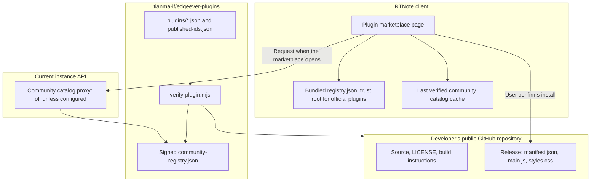

# RTNote Community Plugin Marketplace Plan

This document describes how community plugins are admitted, distributed with signatures and merged in the client. Installing and auto-updating official plugins still uses the bundled `extensions/registry.json` as the root of trust. The community catalog only adds entries; it never rewrites official ones.

A marketplace listing means the plugin passed public-source, license and Release byte-pinning checks when it was admitted. It does not mean RTNote guarantees the plugin is safe. An enabled plugin is still trusted code inside the page; declared permissions are shown for information and do not block APIs. Installing by pasting a GitHub repository or Manifest URL directly is unchanged.

See also the [marketplace submission policy](plugin-marketplace-policy.md).

---

## 1. Background and goals

The marketplace index is currently bundled at `apps/web/public/extensions/registry.json` and ships with the web deployment and the desktop installer. It holds only two official entries, `org.edgeever.tasks` and `org.edgeever.plugins.ai-rss`. A new listing waits for a main release, and desktop users then wait for an app update.

Goals:

- Listing a community plugin no longer follows RTNote app releases.
- Maintainers merge the first admission; later versions from the same repository get updated checksums from CI when permissions, license and ownership are unchanged.
- The client overlays only a signature-verified community catalog on the bundled official list.
- Self-hosted instances do not request the community catalog by default.

Explicitly out of scope:

- Treating the remote index as an update source for official plugins, or letting it carry `publisher: "edgeever"`.
- Describing "the repository contains `src/`" or a static scan of `main.js` as a reproducible build or a runtime sandbox.
- Requesting the community catalog during app start-up sync.
- Widening the existing GitHub proxy's read scope to check licenses or source trees.

---

## 2. Trust boundary

Official entries update silently today. `resolveOfficialGithubEntry` treats the version in the bundled registry as a floor, fetches newer Releases from the entry's `repositoryUrl` and installs them automatically with new checksums. Plugin code can read notes and make its own network requests. A remote file that could change an official entry's repository URL, or add `publisher: "edgeever"` to any entry, would therefore gain the official plugins' auto-update rights.

The community catalog follows these rules.

| Rule | Requirement |
| :--- | :--- |
| Source of official entries | Only the app's bundled `extensions/registry.json`. At start-up `syncFromCatalogOnce` keeps reading only this file to collect official plugin IDs. |
| Source of community entries | Only a signature-verified community registry. It must not contain `publisher`. |
| Same ID | The bundled entry wins; a remote entry with the same ID is dropped. |
| Reserved namespace | `org.edgeever.*` may appear only in the bundled list. Community registry entries with that prefix are dropped. |
| Official auto-update | Only follows the repository URL in the bundled entry. The community catalog cannot replace it. |
| Signature failure, timeout, parse failure | Drop this remote result. The bundled list on screen and the last verified community cache stay as they are. |
| Removal | Uses `revocations` records in the signed registry. Disappearing from the list is not removal. The client's set of seen revoked IDs only grows, so an old signed file cannot bring a removed plugin back. |
| Fetch timing | Fetched when the user opens the plugin marketplace. The bundled list and local cache show first, then refresh in the background. |

Revocation records stop newer clients from installing, updating or auto-updating the plugin, and tell users who installed it to disable it. Clients that have not upgraded do not know this table, so an emergency removal of an official plugin still needs an app update.

Signatures use Ed25519 over the registry's raw bytes. The public key is built into the client, which accepts both the current and the previous key so a client release can ship before key rotation. The signing key lives only in the release environment of `tianma-if/edgeever-plugins`, never in the RTNote main repository. The signature proves the file came from that key; the client still drops `publisher`, official IDs and the reserved prefix as above and never honours those fields because of a signature.

---

## 3. Architecture

Community metadata lives in a separate repository, `tianma-if/edgeever-plugins`. Official plugins stay in the main repository and are not written there.



Install bytes are still downloaded from the developer's GitHub Release through the instance's existing `/api/v1/plugins/github/...` proxy. The client checks them again against the SHA-256 in the community entry. The community catalog does not host `main.js`.

Repository layout:

```text
tianma-if/edgeever-plugins
├── .github/workflows/
│   ├── verify-submission.yml      # Runs the same checks as locally on PRs
│   ├── publish-registry.yml       # Aggregates, signs and publishes only after pushes to main
│   └── refresh-releases.yml       # New Releases of admitted repositories: update checksums automatically if permissions did not grow
├── plugins/
│   └── com.example.readwise.json  # One file per plugin; kept after removal
├── published-ids.json             # Every ID ever published; only grows
├── scripts/
│   ├── verify-plugin.mjs
│   └── compile-registry.mjs
├── schemas/
│   └── plugin-submission.schema.json
└── README.md
```

`compile-registry.mjs` reads `plugins/*.json`. Active entries go into `entries`; entries with `status: "revoked"` go into `revocations` and are removed from `entries`. Every ID in `published-ids.json` must be either an active entry or have a revocation record; deleting a plugin file fails the publish. Community entries always have `distribution.type` set to `github`. Plugins offered only by Manifest URL can still be installed directly but do not enter the community catalog.

The published output is a pair of files: `community-registry.json` and `community-registry.json.sig`. They are served from RTNote's own hostname with a short cache (`max-age=60`). Public caches such as jsDelivr, which this repository cannot purge immediately, are not used.

---

## 4. Admission and updates

The local check and CI use the same `verify-plugin.mjs`. It parses the Manifest with `@edgeever/plugin-api` and reuses the client's existing size limits: `manifest.json` 256 KiB, `main.js` 5 MiB, `styles.css` 1 MiB.

### First admission

The developer opens a PR against `tianma-if/edgeever-plugins` that only adds `plugins/<id>.json`. CI fetches again from the single `repositoryUrl` in that file and ignores any other address in the PR description.

The submitter must have write access to the source repository. CI checks this through the GitHub API; when the API cannot confirm it, the commit being admitted on the source repository's default branch must contain `.edgeever/marketplace-claim` whose content is the PR's full URL. If neither holds, the merge is refused. This stops anyone claiming a plugin ID with someone else's public repository.

Before merging, a maintainer checks that the source, build instructions and Release match. Passing CI only means the mechanical checks passed.

| Check | Passes when | What it cannot prove |
| :--- | :--- | :--- |
| Repository visibility | Anonymous access to repository metadata returns 200. 404 or any other status is refused. No token able to read private repositories is issued for this check. | |
| License | The repository root has a license file recognised as an OSI-approved SPDX identifier. When the GitHub License API returns `NOASSERTION`, recognise the local license text instead. License compatibility of dependencies is the author's responsibility, and third-party notices are reviewed at the first manual review. | |
| Readable source | The plugin repository contains human-readable source and build instructions, not only a bundled `main.js`. Themes have no `main.js`; check the full theme Manifest and license instead. | That the Release's `main.js` was compiled from that commit. |
| Version traceability | The Release tag points to an immutable commit. Record the 40-character commit SHA and compute SHA-256 for `manifest.json`, `main.js` (optional for themes) and the optional `styles.css`. | This is byte pinning, not a reproducible build. |
| Manifest consistency | The Manifest's ID, version and `apiVersion` match the entry. The plugin ID matches `^[a-z0-9]+(?:[._-][a-z0-9]+)+$` and does not use `org.edgeever.*`. The entry has no `publisher`. | |
| Permission snapshot | Write the version's Manifest `permissions` and `networkHosts` into the entry's `admitted` field for later auto-update comparison. | `networkHosts` is not a runtime isolation boundary. |
| Static scan | Flag `eval`, `new Function` and remote script loading in the plugin's `main.js`, and post the result on the PR for reviewers. Skipped for themes. | Bundles cause false positives and string concatenation causes misses. This check alone never blocks a merge. |

### Updating admitted versions

When `refresh-releases.yml` finds a new Release in an admitted repository, a bot opens a PR that changes only the version, commit SHA and checksums. It merges automatically when all of these hold:

- The repository owner and name are unchanged;
- The plugin ID is unchanged;
- The license SPDX identifier is unchanged;
- The new Manifest's `permissions` and `networkHosts` do not exceed the recorded `admitted` snapshot;
- `apiVersion` is still accepted by current clients;
- The mechanical checks in section 4 pass.

Ownership changes, license changes, wider permissions or `networkHosts`, and `apiVersion` changes are left for manual review. The bot cannot change the `admitted` snapshot.

### Removal

A maintainer sets the file's `status` to `revoked` with a `reason` and `revokedAt`. The file and its ID in `published-ids.json` are kept. Plugins are removed under the listing policy when the repository becomes private, the license is deleted, ownership is transferred, or the plugin's behaviour creates security or privacy risks.

---

## 5. Registry format

`registryVersion` stays `"1"`. The existing `parseMarketplaceRegistry` drops unknown fields, so older clients still parse the bundled list when they meet new fields. Community fields ship in a client release first and are used by the marketplace UI afterwards.

The community registry adds optional information to the existing fields:

```json
{
  "registryVersion": "1",
  "updatedAt": "2026-10-05T00:00:00.000Z",
  "entries": [
    {
      "id": "com.example.readwise",
      "name": "Readwise",
      "description": "Imports Readwise highlights into notes.",
      "author": "Example",
      "category": "Import",
      "repositoryUrl": "https://github.com/example/readwise",
      "distribution": {
        "type": "github",
        "repositoryUrl": "https://github.com/example/readwise"
      },
      "verification": {
        "version": "1.2.0",
        "checksums": {
          "manifestJson": "<sha256>",
          "mainJs": "<sha256>"
        }
      },
      "licenseSpdx": "MIT",
      "sourceRevision": "<40-char commit sha>",
      "admitted": {
        "permissions": ["notes:write"],
        "networkHosts": ["readwise.io"]
      }
    }
  ],
  "revocations": [
    {
      "id": "com.example.old",
      "reason": "Repository was made private",
      "revokedAt": "2026-10-05T00:00:00.000Z"
    }
  ]
}
```

Community entries have no `publisher`. `licenseSpdx`, `sourceRevision`, `admitted` and the top-level `revocations` take effect only in newer clients. Checksum fields are still limited to `manifestJson`, `mainJs` and `stylesCss`.

---

## 6. Client behaviour

Start-up sync does not request the community catalog; official plugin IDs are still read only from the bundled registry. This avoids waiting on the network at every start and avoids treating official plugins as community plugins when a request fails.

When the user opens the plugin marketplace:

1. Immediately show the bundled official entries and the last verified community catalog from IndexedDB.
2. If the current instance has a community catalog configured, request the latest file and signature from the instance.
3. Verify the signature with the built-in public key. On failure, keep the view from step 1.
4. When merging, drop entries with `publisher`, `org.edgeever.*` entries and IDs that conflict with bundled entries.
5. Filter by the local plugin `apiVersion`; hide entries that cannot be installed.
6. Add new revoked IDs to the local grow-only set. Revoked entries are hidden; if already installed, the plugin page suggests disabling them. Official auto-update skips these IDs before running.
7. Cache the verified raw bytes, signature and `updatedAt`. A signed file with an older `updatedAt` cannot overwrite the cache.

Community plugin updates follow the existing rules: when the registry has a higher version, the card shows an update, the user clicks to install, and changed declared capabilities are listed. Community plugins never update silently. Community plugins from the marketplace still go through the existing community plugin trust confirmation. The UI shows the license and a "Community" badge. Copy keeps the meaning set in the listing policy: verified means admission checks, not a safety guarantee.

Self-hosted instances leave the community catalog URL unset by default, so the marketplace shows only bundled official plugins. The official deployment enables the feature with the instance environment variable `EDGE_EVER_COMMUNITY_REGISTRY_URL`. The client never hardcodes an external CDN address.

The instance adds an authenticated `GET /api/v1/plugins/community-registry`. Without the environment variable it returns 404. When configured, the instance fetches the registry and signature and returns them unchanged; the client verifies the signature itself. The endpoint does not accept arbitrary caller-supplied URLs and does not read licenses or source trees.

---

## 7. Submission entry point

The in-app wizard comes after client merging and signature verification are done. It uses only what the existing GitHub proxy already provides:

- Whether the repository URL resolves to a public repository's Manifest;
- Whether the Manifest's ID, version and `apiVersion` are acceptable to the current client;
- Whether the matching Release contains the required assets.

The wizard does not check licenses or source directories. The developer runs the full `verify-plugin.mjs` locally, and the PR runs the same script. After the pre-check passes, the wizard opens an issue template prefilled with the repository URL and plugin ID; both must match `plugins/<id>.json` in the PR, and the issue body is not used as the basis for admission.

Settings can link to the developer documentation and the repository README first. Until the wizard ships, submitting means opening a PR as the README describes.

---

## 8. Implementation order

1. **Separate repository and verification script.** Create `tianma-if/edgeever-plugins` with verification, aggregation, signed publishing and automatic updates for admitted versions. The RTNote client does not change in this phase; official plugins still ship with the main project.
2. **Client understands the new fields and verifies signatures.** Extend `parseMarketplaceRegistry` with the optional fields while keeping `registryVersion` at `"1"`. Implement fetching when the marketplace opens, signature verification, merging, remembered revocations and `apiVersion` filtering. The instance proxy is off by default.
3. **Marketplace display.** Community entries show the license and a community badge, with manual refresh. Trust confirmation copy keeps treating them as community plugins.
4. **In-app pre-check wizard.** Reuses only the existing Manifest and Release reads. No new source-tree or license proxy.

---

## 9. Risks and rollback

Phase one changes no client behaviour. Rolling back means no longer merging PRs in that repository.

If the community catalog or the signing key is abused, an attacker can list a new community plugin or replace the pinned bytes of an admitted plugin. Users still install community plugins themselves, and this file cannot redirect official plugins' repository URLs or auto-updates. The response is to publish revocation records with a key that has not leaked; if the current key can no longer be trusted, first ship a client that trusts only a new public key and ignores the community catalog. Installed copies keep running until the user disables them.

Self-hosted instances without `EDGE_EVER_COMMUNITY_REGISTRY_URL` never contact the community catalog. The official instance fetches the file only when a user opens the plugin marketplace and the proxy is called.
